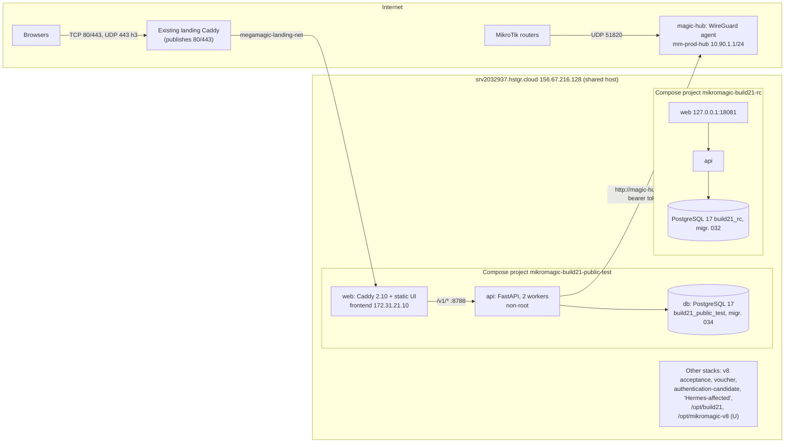

# MikroMagic — Hostinger VPS infrastructure handover

Prepared 2026-10-10 (23:30 UTC+6:30) in the Build 21 v8 corrective copy.
Scope: local documentation and configuration inspection plus anonymous public
observation only. No SSH session, Hostinger panel/API call, port scan,
WireGuard probe, database read, restart, deployment or configuration change
was made. No secret value was read into, or written to, this document.

## Update — live verification and approved changes (2026-10-10, 17:00–17:30 UTC)

After this inventory was written, the owner made the decisions below and approved
live verification, credential rotation and redeployment. The engineer owns
implementation. This section **supersedes** every **U** row and any conflicting
statement below.

Owner decisions:
- Production target is this Hostinger VPS (`megamagic.tech`).
- Z.com and `mikromagic.com` are discontinued.

### Verified on the VPS

| Area | Verified fact |
|---|---|
| OS and size | Ubuntu 24.04.5, kernel 6.8.0-142, 4 vCPU, 16 GB RAM, 193 GB disk (13 GB used) |
| Docker | Docker 29.8.2, Compose 5.6.0 |
| Host services | fail2ban and unattended-upgrades active. Legacy `mm-backup.timer` (not Build 21) fails nightly; it was left untouched. |
| Firewall | UFW active, allowing 22, 80, 443, 51820/udp and 51821/udp (IPv4 and IPv6) |
| Reverse proxy | The `megamagic-landing-caddy-1` container binds `156.67.216.128:80/443` and routes `megamagic.tech` and `www` to `mikromagic-build21-public-test-web` over `megamagic-landing-net` |
| Co-hosted stacks (untouched) | `megamagic-landing`, `mikromagic-build21-rc` (127.0.0.1:18081), `mikromagic-v8-acceptance` (127.0.0.1:8080/8443), `v8-auth-candidate`, `v8-auth-final-retest-20261009`, `v8-auth-pgtest` (exited), `voucher-pg-20261009` |
| Deployment directories | `-20261010` = `4e78…` (first public test); `-hub-20261010T143844Z` = `6288…` (Hub release); `-20261010T150700Z` = `6514…`; `-20261010T171319Z` = `4092…`; `-20261010T180343Z` = `5f93…` (migration 037); `-20261010T182316Z` = `379f…` (migration 038); `-20261010T185246Z` = `379f…` (first scripted deploy); `-20261010T195352Z` = `601e…` (migration 039); `-20261010T201247Z` = `201e…` (migration 040); `-20261010T203831Z` = `4fba…` (migration 041); `-20261011T073612Z` = `0d55…` (daily voucher counts); `-20261011T075349Z` = `3d90…` (batch QR); `-20261011T082054Z` = `ae40…` (migration 042); `-20261011T084421Z` = `5098…` (migration 043); `-20261011T090702Z` = `7ce9…` (public Demo, migration 043); `-20261011T093325Z` and `-20261011T093659Z` = `7fbb…` (subscription renewal, migration 044; the same artifact deployed twice); `-20261011T095239Z` = `c46f…` (Developer Dashboard, migration 045); `-20261011T100858Z` = `cf02…` (Application settings, no migration); `-20261011T103908Z` = `ac75…` (Referral Agents, migration 046); `-20261011T112427Z` = `e6ae…` (current, Smart Notification Center, migration 047); `-20261010T184257Z` and `-20261010T184809Z` never served traffic |

The `6514…` artifact (the guest access diagnosis) **was deployed** at 15:07 UTC,
which no project document recorded. The `bfbe…` digest reported in Discrepancy 3
is not drift: `tests/test_public_test_package.py` rebuilds the local zip.

### Problems found and fixed

1. **The Magic Hub was never reachable from the internet.**
   - Cause: `magic-hub` was attached only to an `internal: true` Docker network, and Docker publishes no ports for such containers.
   - Fix: added a `hub_uplink` network.
   - Proof: `docker port` now shows `156.67.216.128:51820`, and an external UDP packet incremented the DNAT counter. The Hub public key is unchanged (`TG1jLN13+hA1Eg9/1h0DykQ768ZHZO54WFGAZWhjL0o=`), with 0 peers.
2. **The database password file was world-readable** to every container that mounted it.
   - Fix: split it into a database copy (`root:70 0440`) and an API copy (`root:101 0440`).
   - Older deployment directories were tightened the same way.
3. **The deployed build predated the legacy-staff freeze.** The redeploy below fixed it.

### Redeploy (current source)

| Item | Value |
|---|---|
| Artifact | `4092ce1da282388f59ef1ef23e9ecb57adae45cccf85a26eb80ccb11f7ffeb1b` (149 files) |
| Directory | `/opt/mikromagic-build21-public-test-20261010T171319Z` (`RELEASE_SHA256`, `build.log`, `migrate.log`, `up.log`) |
| Pre-deploy database dump | `backups/pre-deploy.dump` in that directory (347 restore-list entries) |
| Rollback images | `mikromagic-build21-public-test-{api,web,magic-hub,migrate}:rollback-20261010T171319Z` |
| Result | All four containers healthy, migrations at head `034`, HTTPS 200, browser sign-in renders with no failed resources, and legacy-staff rules are live |

**Rollback:**
1. Retag the `rollback-20261010T171319Z` images as the running tags.
2. Run `docker compose up -d` from the `-20261010T150700Z` directory.
3. Restore `pre-deploy.dump` only if a migration caused the problem. No migration was added in this deploy.

### Redeploy — voucher lifecycle, production jobs and templates (2026-10-10 18:03 UTC)

| Item | Value |
|---|---|
| Artifact | `5f9312fa1910a4e8bc49e0df4e3f438ca9c3805ade089f979310ddbcd53b043c` (157 files); local checks before upload: 499 backend, 39 frontend and 4 Sites tests passed |
| Directory | `/opt/mikromagic-build21-public-test-20261010T180343Z` (`RELEASE_SHA256`, `backups/{build,migrate,up}.log`) |
| Unchanged from previous release | Compose file, `docker/Caddyfile`, `Dockerfile.api`, `.env`, secrets (copied with permissions), Hub source (`hub_agent.py`, `requirements.hub.txt`) |
| Pre-deploy database dump | `backups/pre-deploy.dump` (347 restore-list entries, SHA-256 in `pre-deploy.dump.sha256`); data at the time: 1 user, 0 tenants, 0 vouchers |
| Migrations | 034 → 037 (`035_voucher_code_rules`, `036_voucher_lifecycle`, `037_voucher_production`) |
| Rollback images | `mikromagic-build21-public-test-{api,web,magic-hub,migrate}:rollback-20261010T180343Z` |
| Result | api and web recreated and healthy; db and Hub left running (Hub public key unchanged, UDP 51820 still published); `https://megamagic.tech`, `www` and `/v1/ready` return 200; served bundle `index-Dadu6M7I.js` equals the local build; `/v1/voucher-jobs` returns 401 without a session; browser sign-in shows "Sign-in service available" with no failed resources; no API errors in the log |

**Rollback:** retag the `rollback-20261010T180343Z` images as the running tags,
and run `docker compose up -d` from `-20261010T171319Z`. The 035–037 additions
are new tables and nullable columns, so the older code can run on the
migrated database. Restore `pre-deploy.dump` only if a migration itself caused
the problem; Alembic downgrade refuses while production jobs, templates or
serials exist.

### Redeploy — dealers and physical stock (2026-10-10 18:23 UTC)

| Item | Value |
|---|---|
| Artifact | `379fa032ff5d7e2406b54e3c7c24c7a70af504f771aa503fbd39595033f50c98` (161 files); local checks: 504 backend, 44 frontend, 4 Sites tests passed, browser walk-through on a scratch database |
| Directory | `/opt/mikromagic-build21-public-test-20261010T182316Z` (`RELEASE_SHA256`, `backups/{build,migrate,up}.log`) |
| Unchanged from previous release | Compose file, Caddyfile, all three Dockerfiles, `.env`, secrets, Hub source |
| Pre-deploy database dump | `backups/pre-deploy.dump` (365 restore-list entries); data: 1 user, 0 tenants, 0 vouchers, 0 jobs |
| PostgreSQL rehearsal | The dump was restored into a throwaway `postgres:17-alpine` container on an internal-only temporary network; 037 → 038, `fk_vouchers_dealer` and dealer constraints present, downgrade to 037 and upgrade to 038 both clean; container and network removed afterwards |
| Migration | 037 → 038 (`038_dealers`) |
| Rollback images | `mikromagic-build21-public-test-{api,web,magic-hub,migrate}:rollback-20261010T182316Z` |
| Result | api and web recreated and healthy; db and Hub untouched (Hub key unchanged, UDP 51820 published); `https://megamagic.tech`, `www` and `/v1/ready` return 200; served bundle `index-DoAW5Ion.js` equals the local build; `/v1/dealers` returns 401 without a session; sign-in renders with no failed resources; no API errors in the log |

**Rollback:** retag the `rollback-20261010T182316Z` images and run
`docker compose up -d` from `-20261010T180343Z`. Migration 038 only adds
tables and nullable columns, so the older code runs on it; restore
`pre-deploy.dump` only if the migration itself is at fault.

### Scripted redeploy — same code, first run of `scripts/deploy-hostinger-public-test.sh` (2026-10-10 18:52 UTC)

| Item | Value |
|---|---|
| Source | Commit `eb79b37` on `origin/main` ([RionishJovian/Hostinger](https://github.com/RionishJovian/Hostinger)); artifact `379fa032…` (161 files), unchanged from 18:23 |
| Directory | `/opt/mikromagic-build21-public-test-20261010T185246Z`; previous `-20261010T182316Z` |
| Pre-deploy dump | `backups/pre-deploy.dump` (398 restore-list entries); migration 038 → 038, so no rehearsal |
| Rollback images | `…-{api,web,magic-hub,migrate}:rollback-20261010T185246Z`, tagged from the images the containers were running |
| Result | api and web recreated on the new images and healthy; db and Hub untouched (Hub key and UDP 51820 unchanged); HTTPS 200 for both names and `/v1/ready`; served bundle `index-DoAW5Ion.js` equals the local build; no API errors |

Two earlier attempts left directories that never served traffic: `-20261010T184257Z` (the VPS steps
were fed through stdin and `docker compose run` consumed the rest; it stopped after the no-op
migration) and `-20261010T184809Z` (completed, but recreated nothing). Both are fixed in the script.

**Docker Compose v5.6 on this VPS does not recreate a container when only its image changes.**
The script therefore force-recreates api and web (and the Hub only for a reviewed Hub change) and
checks that they run the newly built images. Any rollback must also use
`up -d --no-deps --force-recreate <services>` after retagging; a plain `up -d` keeps the current
containers. This applies to the rollback notes of the earlier redeploys above.

### Scripted redeploy — voucher sale payment methods and Cancel Sale (2026-10-10 19:53 UTC)

| Item | Value |
|---|---|
| Source | Commit `17beab6` on `origin/main`; artifact `601e8945be546b3f5e20a9b3571709f00511dc656ea174b23e6d564536a1d80b` (163 files); local checks: 507 backend (12 skipped), 47 frontend tests, build, manifest; browser walk-through on a scratch database |
| Directory | `/opt/mikromagic-build21-public-test-20261010T195352Z`; previous `-20261010T185246Z` |
| Infra / Hub files | Unchanged |
| Pre-deploy dump | `backups/pre-deploy.dump` (398 restore-list entries) |
| PostgreSQL rehearsal | 038 → 039 → 038 → 039 clean on a throwaway database |
| Migration | 038 → 039 (`039_cancel_voucher_sale`); live `voucher_sales` has `uq_voucher_sales_active_voucher`, `fk_voucher_sales_cancelled_by` and the amount check, and no longer has the plain unique constraint |
| Rollback images | `…-{api,web,magic-hub,migrate}:rollback-20261010T195352Z` |
| Result | api and web recreated and healthy; db and Hub untouched (Hub key and UDP 51820 unchanged); HTTPS 200; served bundle `index-CeTuxk_1.js` equals the local build; `POST /v1/vouchers/{id}/sale/cancel` returns 401 without a session |

**Rollback:** retag the `rollback-20261010T195352Z` images, then
`up -d --no-deps --force-recreate api web` from `-20261010T185246Z`. The 038 code
expects a unique `voucher_id` and does not know about cancellation; it still runs on
039 while no sale has been cancelled. Downgrading to 038 refuses once a cancelled
sale exists; restore `pre-deploy.dump` only if the migration itself is at fault.

### Scripted redeploy — shop setting: default printed Wi-Fi name (2026-10-10 20:12 UTC)

| Item | Value |
|---|---|
| Source | Commit `78e1c53` on `origin/main`; artifact `201e26e3bfe88a249de512e7af75d10bf1628e88c03fa6082a325d258de747c8` (165 files); local checks: 508 backend (12 skipped), 50 frontend tests, build, manifest; browser walk-through on a scratch database |
| Directory | `/opt/mikromagic-build21-public-test-20261010T201247Z`; previous `-20261010T195352Z` |
| Infra / Hub files | Unchanged |
| Pre-deploy dump | `backups/pre-deploy.dump` (399 restore-list entries) |
| PostgreSQL rehearsal | 039 → 040 → 039 → 040 clean on a throwaway database |
| Migration | 039 → 040 (`040_site_printed_ssid`); live `sites.printed_ssid` is `character varying(32)` |
| Rollback images | `…-{api,web,magic-hub,migrate}:rollback-20261010T201247Z` |
| Result | api and web recreated and healthy; db and Hub untouched (Hub key and UDP 51820 unchanged); HTTPS 200; served bundle `index-BhkTAnBU.js` equals the local build; `POST /v1/sites/{id}/settings` returns 401 without a session |

**Rollback:** retag the `rollback-20261010T201247Z` images, then
`up -d --no-deps --force-recreate api web` from `-20261010T195352Z`. Migration 040
only adds a nullable column, so the 039 code runs on it; downgrading refuses while
any shop has a printed Wi-Fi name.

### Owner platform account (2026-10-10 20:24 UTC)

- At the owner's request, created `nish@magic` with the existing `platform` role (full operator access; there is no separate Developer role in the app or the Notion tracker). Temporary password generated locally, delivered only through the owner's clipboard, valid 24 hours, with a forced change at first sign-in. Audit action `platform_account_provisioned`.
- Before writing: `backups/pre-platform-account-20261010T202406Z.dump` in `-20261010T201247Z` (414 restore-list entries).
- Verified: sign-in on `https://megamagic.tech` returns the platform role with the password change required; the test session was signed out.
- `public-test-owner` (platform) was still active at that point; its password was never recorded. Owner decision: disable it once `nish@magic` is confirmed working.

### Scripted redeploy — Platform console for the platform owner (2026-10-10 20:38 UTC)

| Item | Value |
|---|---|
| Source | Commit `2d8e238` on `origin/main`; artifact `4fba51b73ca5286376969d4a39271d39679591a0da24fc3e4aa90a5b168d3747` (168 files); local checks: 512 backend (12 skipped), 50 frontend tests, build, manifest; browser walk-through on a scratch database |
| Directory | `/opt/mikromagic-build21-public-test-20261010T203831Z`; previous `-20261010T201247Z` |
| Infra / Hub files | Unchanged |
| Pre-deploy dump | `backups/pre-deploy.dump` (399 restore-list entries) |
| PostgreSQL rehearsal | 040 → 041 → 040 → 041 clean on a throwaway database |
| Migration | 040 → 041 (`041_platform_owner`): `users.platform_owner` boolean, default false |
| Rollback images | `…-{api,web,magic-hub,migrate}:rollback-20261010T203831Z` |
| Result | api and web recreated and healthy; db and Hub untouched (Hub key and UDP 51820 unchanged); HTTPS 200; served bundle `index-Ci4Q7lb3.js` contains the Platform console; both `/v1/platform/console/*` endpoints return 401 without a session |

**Rollback:** retag the `rollback-20261010T203831Z` images, then
`up -d --no-deps --force-recreate api web` from `-20261010T201247Z`. Migration 041
only adds a defaulted column, so the 040 code runs on it.

### Platform owner flag and old operator account (2026-10-10 20:40 UTC)

- The audit log shows `nish@magic` changed its temporary password at 20:24:40 and signed in again at 20:34:41, so the account works with the owner's own password.
- Set `platform_owner` on `nish@magic` only (audit `platform_owner_granted`). Before writing: `backups/pre-platform-owner-20261010T203954Z.dump` in `-20261010T203831Z` (414 entries).
- Disabled `public-test-owner` (`active=false`, its sessions removed; it had none). Audit `platform_account_disabled`. Before writing: `backups/pre-disable-public-test-owner-20261010T204016Z.dump` (414 entries). Re-enable by setting `active=true` if ever needed.
- Live state: `nish@magic` active, platform owner; `public-test-owner` inactive. Only `nish@magic` sees the Platform console.

### Scripted redeploy — daily voucher counts per shop and for all shops (2026-10-11 07:36 UTC)

| Item | Value |
|---|---|
| Source | Commit `60d4d0d` on `origin/main`; artifact `0d553aad26657143365f81824c37e0bd87b907b289f1f9be3e2695e76b2962af` (169 files); local checks: 513 backend (12 skipped), 53 frontend tests, build, manifest, revenue and voucher UI checks; browser walk-through on a scratch database |
| Directory | `/opt/mikromagic-build21-public-test-20261011T073612Z`; previous `-20261010T203831Z` |
| Infra / Hub files | Unchanged |
| Pre-deploy dump | `backups/pre-deploy.dump` (399 restore-list entries) |
| Migration | None (041 → 041); rehearsal skipped by the script |
| Rollback images | `…-{api,web,magic-hub,migrate}:rollback-20261011T073612Z` |
| Result | api and web recreated and healthy; db and Hub untouched (Hub key and UDP 51820 unchanged); HTTPS 200; `/v1/ready` 200; served bundle `index-XEZUB3ve.js` contains the new Revenue columns; `/v1/revenue` returns 401 without a session |

**Rollback:** retag the `rollback-20261011T073612Z` images, then
`up -d --no-deps --force-recreate api web` from `-20261010T203831Z`. No schema change.

### Scripted redeploy — batch QR on voucher sheets and thermal runs (2026-10-11 07:53 UTC)

| Item | Value |
|---|---|
| Source | Commit `6adffd0` on `origin/main`; artifact `3d90ae11527abe19f1bda234307b7fa802be5ca00033904172679377ff3a4bd9` (170 files); local checks: 514 backend (12 skipped), 58 frontend tests, build, manifest, voucher and revenue UI checks; browser walk-through on a scratch database |
| Directory | `/opt/mikromagic-build21-public-test-20261011T075349Z`; previous `-20261011T073612Z` |
| Infra / Hub files | Unchanged |
| Pre-deploy dump | `backups/pre-deploy.dump` (399 restore-list entries) |
| Migration | None (041 → 041); rehearsal skipped by the script |
| Rollback images | `…-{api,web,magic-hub,migrate}:rollback-20261011T075349Z` |
| Result | api and web recreated and healthy; db and Hub untouched (Hub key and UDP 51820 unchanged); HTTPS 200; `/v1/ready` 200; served bundle `index-BiTzHKQ-.js` contains the batch QR setting and the scanned-batch sign-in hint; a `?batch=…&sheet=1` link returns 200 |

**Rollback:** retag the `rollback-20261011T075349Z` images, then
`up -d --no-deps --force-recreate api web` from `-20261011T073612Z`. No schema change.

### Scripted redeploy — shop hours and planned maintenance, migration 042 (2026-10-11 08:21 UTC)

| Item | Value |
|---|---|
| Source | Commit `72c28ee` on `origin/main`; artifact `ae40b04e9abf99dc11f8c7809195b9bfbcba80979845f385b9d5fd50449e91eb` (174 files); local checks: 563 backend (12 skipped), 62 frontend tests, build, manifest, voucher and revenue UI checks; SQLite upgrade/downgrade/upgrade; browser walk-through on a scratch database |
| Directory | `/opt/mikromagic-build21-public-test-20261011T082054Z`; previous `-20261011T075349Z` |
| Infra / Hub files | Unchanged |
| Pre-deploy dump | `backups/pre-deploy.dump` (399 restore-list entries) |
| Migration | 041 → 042 (additive: hours columns on `sites`, `site_incidents.expected_reason`, table `site_maintenance`); PostgreSQL rehearsal 041 → 042 → 041 → 042 clean |
| Rollback images | `…-{api,web,magic-hub,migrate}:rollback-20261011T082054Z` |
| Result | api and web recreated and healthy; db and Hub untouched (Hub key and UDP 51820 unchanged); HTTPS 200; `/v1/ready` 200; served bundle `index-B1TDoSmo.js` contains the hours and maintenance UI; `/v1/sites/{id}/hours` returns 401 without a session; read-only SQL: `alembic_version` 042, `site_maintenance` 0 rows, 0 incidents labelled expected, no shops yet |

**Rollback:** retag the `rollback-20261011T082054Z` images, then
`up -d --no-deps --force-recreate api web` from `-20261011T075349Z`. The 042 columns and table are additive and unused by the old code; restore `backups/pre-deploy.dump` only if the migration itself is at fault.

### Scripted redeploy — Magic Support Mode / Get help, migration 043 (2026-10-11 08:44 UTC)

| Item | Value |
|---|---|
| Source | Commit `82adb54` on `origin/main`; artifact `509833f3da43c0709120b806b77e7d31b8749293da610f1eea1b5c32ff12fdec` (178 files); local checks: 610 backend (12 skipped), 65 frontend tests, build, manifest, voucher and revenue UI checks; SQLite upgrade/downgrade/upgrade; browser walk-through on a scratch database |
| Directory | `/opt/mikromagic-build21-public-test-20261011T084421Z`; previous `-20261011T082054Z` |
| Infra / Hub files | Unchanged |
| Pre-deploy dump | `backups/pre-deploy.dump` (408 restore-list entries) |
| Migration | 042 → 043 (additive: table `support_reports`); PostgreSQL rehearsal 042 → 043 → 042 → 043 clean |
| Rollback images | `…-{api,web,magic-hub,migrate}:rollback-20261011T084421Z` |
| Result | api and web recreated and healthy; db and Hub untouched (Hub key and UDP 51820 unchanged); HTTPS 200; `/v1/ready` 200; served bundle `index-CahlLpR6.js` contains the Get help page and the platform shared-reports panel; `/v1/support-reports` returns 401 without a session; read-only SQL: `alembic_version` 043, `support_reports` 0 rows |

**Rollback:** retag the `rollback-20261011T084421Z` images, then
`up -d --no-deps --force-recreate api web` from `-20261011T082054Z`. The 043 table is additive and unused by the old code; restore `backups/pre-deploy.dump` only if the migration itself is at fault.

### Credential rotation and access

- A new dedicated SSH key, `~/.ssh/mikromagic-hostinger-20261010`, is the only authorized root key (fingerprint `SHA256:YgnX3RLZ…`). The Mac reaches the VPS as `ssh mikromagic-hostinger`, with strict host-key checking.
- Old keys are rejected and were moved to `~/.ssh/retired-20261010/`.
- 2026-10-11 (owner request): a second root key for Cursor cloud agents, comment `cursor-cloud-agent-mikromagic-20261011`, fingerprint `SHA256:QhrYUh7P…`, restricted with `no-agent-forwarding,no-X11-forwarding,no-port-forwarding`. Backup before the change: `/root/.ssh/authorized_keys.bak-20261010T183409Z`. Cloud agents receive it as the `MIKROMAGIC_VPS_SSH_KEY_B64` runtime secret and connect with the pinned host key `deploy/known_hosts.hostinger`. To revoke it, delete that line from `/root/.ssh/authorized_keys`; the Mac key is unaffected.
- sshd now refuses all passwords (`PermitRootLogin prohibit-password`, `PasswordAuthentication no`). The main `sshd_config` has no `Include`, so drop-in files are ignored.
- Removed from the Mac to the Trash:
  - the plaintext Z.com VPS password in `~/AGENTS.md`;
  - `~/.git-credentials`;
  - `~/Desktop/Mikromagic-VPS-secrets.txt`.
- The Hostinger root console password was not changed. It works only in the Hostinger panel console.

### Backups and recovery

- **Nightly on the VPS:** `mikromagic-build21-backup.timer` runs at 03:45 UTC.
  - It dumps the database, restore-tests it in a throwaway offline container (table count and Alembic head must match), and archives the Hub state.
  - Output goes to `/var/backups/mikromagic-build21/` with SHA256SUMS; the last 7 are kept.
  - First run verified: 51 tables, head 034.
  - Source: `deploy/mikromagic-build21-backup.{sh,service,timer}`.
- **Off-VPS copy:** a Mac launch agent, `tech.megamagic.hostinger-backup-pull`, runs daily at 11:00 local time and on login.
  - It pulls the backups to `~/MikroMagic-offhost-backups`, verifies the checksums and keeps 30 days.
  - Source: `deploy/mac-pull-hostinger-backups.sh`. The first pull verified.
- **Hub key escrow:** the Hub WireGuard private key and the backup encryption key are stored in the Mac login Keychain:
  - `megamagic-production-hub_private_key`;
  - `megamagic-production-backup_key`.

  Both match the VPS, and the escrowed Hub key derives the live Hub public key. If the VPS is lost, a rebuilt Hub can keep the same identity, so routers do not need re-enrolling.
- The retired Z.com backup agent (`com.mikromagic.zcom-backup`) was unloaded. Its last successful backup is from 2026-09-26.

### Still open

- The management path from the API through the Hub to routers, and D1/S1. Connected therefore remains impossible on this host.
- Monitoring is in place since 2026-10-10. A Mac launch agent, `tech.megamagic.production-monitor` (source `deploy/mac-monitor-production.sh`), runs every 30 minutes and checks:
  - `/v1/ready` and the certificates for both names (at least 21 days left);
  - health of the four containers and that Hub UDP 51820 is published;
  - the last VPS backup result, disk use below 85%, and the off-VPS backup age.

  It shows a macOS notification when failures appear, change or clear. Limit: it runs only while the Mac is awake; an external uptime service would cover the gaps.
- A CAA record.
- The legacy `mm-backup.timer` failures.
- Old router tunnel `mmh-8adfeb441215`. Owner decision: during an approved router window, disable it first; delete it only after the new Hub connection is proven.
### Scripted redeploy — public interactive Demo, no migration (2026-10-11 09:07 UTC)

| Item | Value |
|---|---|
| Source | Commit `0f761db` on `origin/main`; artifact `7ce96761ca074e6782b68bfb9a60a247a118a1ee49de616d42030ed99085b29f` (179 files); local checks: 610 backend (12 skipped), 73 frontend tests, build, manifest, voucher and revenue UI checks; local browser walk-through of every demo page |
| Directory | `/opt/mikromagic-build21-public-test-20261011T090702Z`; previous `-20261011T084421Z` |
| Infra / Hub files | Unchanged |
| Pre-deploy dump | `backups/pre-deploy.dump` (417 restore-list entries) |
| Migration | 043 → 043 (none); rehearsal skipped by the script (no new migration) |
| Rollback images | `…-{api,web,magic-hub,migrate}:rollback-20261011T090702Z` |
| Result | api and web recreated and healthy; db and Hub untouched (Hub key and UDP 51820 unchanged); HTTPS 200; `/v1/ready` 200; `/v1/me` 401 without a session; served bundle `index-Dxqkfobc.js` contains **Try the demo** and the demo client, not the development prototype. Live browser check: Try the demo opened "Golden Cafe (demo)" with the eight demo pages, a quick voucher returned `DEMO-…`, and no `/v1/` request was made after entering the demo (only the sign-in page's `health` and `appearance/public`). Read-only SQL: `alembic_version` 043, `tenants` 0 rows |

**Rollback:** retag the `rollback-20261011T090702Z` images, then
`up -d --no-deps --force-recreate api web` from `-20261011T084421Z`. No database change to undo.

### Scripted redeploy — subscription self-service and renewal rules, migration 044 (2026-10-11 09:33 and 09:37 UTC)

| Item | Value |
|---|---|
| Source | Commit `9b7c0f5` on `origin/main`; artifact `7fbb6172c43e4b1aab8815d5c25d0a8004adda2e8620626ca27eba5e4a768d85` (181 files); local checks: 617 backend (12 skipped), 73 frontend tests, build, manifest, staff/subscriptions, billing, voucher and revenue UI checks; SQLite 044 upgrade/downgrade/upgrade; local browser run of expiry, request, approval and the 7-day banner |
| Directories | The deploy command ran twice from the Mac (same key, same artifact): `/opt/mikromagic-build21-public-test-20261011T093325Z` (previous `-20261011T090702Z`) migrated 043 → 044 after the PostgreSQL rehearsal; `/opt/mikromagic-build21-public-test-20261011T093659Z` (current) found 044 → 044 and only recreated api and web. No other agent was involved. |
| Infra / Hub files | Unchanged |
| Pre-deploy dumps | Pre-044 state: `-20261011T093325Z/backups/pre-deploy.dump` (`pre-deploy.alembic` = 043). `-20261011T093659Z/backups/pre-deploy.dump` is already at 044 (421 restore-list entries). |
| Migration | 043 → 044 (`platform_settings` table, empty); rehearsal passed in the first run |
| Rollback images | Pre-044 code: `…-{api,web,magic-hub,migrate}:rollback-20261011T093325Z`. `rollback-20261011T093659Z` holds this same release and is not a rollback target. |
| Result | api and web recreated and healthy; db and Hub untouched (Hub key and UDP 51820 unchanged); `/v1/health` and `/v1/ready` 200; `/v1/subscription/plans` and `/v1/platform/subscription-payment` 401 without a session; served bundle `index-C6bdtao-.js` contains the renewal screen and the payment-details form; no rehearsal containers or networks left. Read-only SQL: `alembic_version` 044, `platform_settings` 0 rows, `tenants` 0 rows |

**Rollback:** retag the `rollback-20261011T093325Z` images, then
`up -d --no-deps --force-recreate api web` from `-20261011T090702Z`. Migration 044 only adds an empty table, so the 043 code runs on it; downgrade or restore `-20261011T093325Z/backups/pre-deploy.dump` only if the table itself is at fault.

### Scripted redeploy — Developer Dashboard first increment, migration 045 (2026-10-11 09:52 UTC)

| Item | Value |
|---|---|
| Source | Commit `f8dc277` on `origin/main`; artifact `c46f937580a7404851d06164652d77833d33331ef1b4fab44e5f03cbb1396a71` (185 files); local checks: 622 backend (12 skipped), 73 frontend tests, build, manifest, all 16 offline UI checks; SQLite 044/045 round trip; local browser suspend/restore and all four dashboard areas |
| Directory | `/opt/mikromagic-build21-public-test-20261011T095239Z`; previous `-20261011T093659Z`. Single run (the deploy now runs behind a lock directory on the Mac). |
| Infra / Hub files | Unchanged |
| Pre-deploy dump | `backups/pre-deploy.dump` (at 044) |
| Migration | 044 → 045; PostgreSQL rehearsal 044 → 045 → 044 → 045 clean |
| Rollback images | `…-{api,web,magic-hub,migrate}:rollback-20261011T095239Z` |
| Result | api and web recreated and healthy; db and Hub untouched; `/v1/health` and `/v1/ready` 200; `/v1/developer/owners` and `/v1/developer/roles` 401 without a session; served bundle `index-UT998k-W.js` contains the Developer Dashboard. Read-only SQL: `alembic_version` 045, `owner_access_events` 0 rows, `tenants` 0; the platform owner account is `active`, the old inactive platform test account became `disabled` (it was already inactive) |

**Rollback:** retag the `rollback-20261011T095239Z` images, then
`up -d --no-deps --force-recreate api web` from `-20261011T093659Z`. Migration 045 adds three columns with defaults and an empty table, so the 044 code runs on it; restore `backups/pre-deploy.dump` only if the migration itself is at fault.

### Scripted redeploy — Developer Dashboard Application settings (2026-10-11 10:08 UTC)

| Item | Value |
|---|---|
| Source | Commit `b653bc5` on `origin/main`; artifact `cf028f7efc8795f600c4d1398540f41f9a8ee1725c278f774e23d8f121969422` (187 files); local checks: 625 backend (12 skipped), 74 frontend tests, build, manifest, all 16 offline UI checks; local browser test of name, logo, languages and announcement |
| Directory | `/opt/mikromagic-build21-public-test-20261011T100858Z`; previous `-20261011T095239Z`. Single run behind the lock directory. |
| Infra / Hub files | Unchanged |
| Pre-deploy dump | `backups/pre-deploy.dump` (at 045, 428 entries) |
| Migration | None (045 → 045); rehearsal skipped by the script because there was no new migration |
| Rollback images | `…-{api,web,magic-hub,migrate}:rollback-20261011T100858Z` |
| Result | api and web recreated and healthy; db and Hub untouched (Hub key and UDP 51820 unchanged); `GET /v1/branding` returns the MikroMagic defaults; `/v1/branding/logo` 404 (no custom logo); `/v1/developer/application`, `/v1/announcement` and the logo upload 401 without a session; served bundle `index-DSKV7Let.js`; the live sign-in page shows the default brand and "Sign-in service available". Read-only SQL: `platform_settings` 0 rows |

**Rollback:** retag the `rollback-20261011T100858Z` images, then
`up -d --no-deps --force-recreate api web` from `-20261011T095239Z`. No schema change; settings saved by this release sit in `platform_settings` rows `application` and `application_logo`, which the older code ignores.

### Scripted redeploy — Referral Agents, migration 046 (2026-10-11 10:39 UTC)

| Item | Value |
|---|---|
| Source | Commit `0980bf6` on `origin/main`; artifact `ac758d1ac2ac8c0393ed7faf564a3deb5668cc6bec3d0a74ba999270ffc2c6bb` (191 files); local checks: 630 backend (12 skipped), 74 frontend tests, build, manifest, all 16 offline UI checks; SQLite 045/046 round trip with data; local browser run of the whole Agent cycle |
| Directory | `/opt/mikromagic-build21-public-test-20261011T103908Z`; previous `-20261011T100858Z`. Single run behind the lock directory. |
| Infra / Hub files | Unchanged |
| Pre-deploy dump | `backups/pre-deploy.dump` (at 045, 428 entries) |
| Migration | 045 → 046; PostgreSQL rehearsal 045 → 046 → 045 → 046 clean |
| Rollback images | `…-{api,web,magic-hub,migrate}:rollback-20261011T103908Z` |
| Result | api and web recreated and healthy; db and Hub untouched (Hub key and UDP 51820 unchanged); Agent, developer Agent and refund endpoints 401 without a session; an invalid application gets 422 with nothing stored; served bundle `index-COxFs4qj.js` shows "Become a MikroMagic Agent" on the sign-in page. Read-only SQL: `alembic_version` 046; `users_role_check`, `users_check` and `subscription_invoices_status_check` recreated under the same names; Agent tables 0 rows; `tenants` 0 |

**Rollback:** retag the `rollback-20261011T103908Z` images, then
`up -d --no-deps --force-recreate api web` from `-20261011T100858Z`. The 045 code runs on the 046 schema while no Agent accounts or refunded invoices exist; once they do, downgrade 046 refuses and the older code would not show them. Restore `backups/pre-deploy.dump` only if the migration itself is at fault.

### Scripted redeploy — Smart Notification Center, migration 047 (2026-10-11 11:24 UTC)

| Item | Value |
|---|---|
| Source | Commit `8529a6c` on `origin/main` (feature `d271cdc` plus a manifest refresh); artifact `e6ae89aebf7c30090226c70aecb942ca2f35ae79a502bb056efca8448e0e9231` (194 files); local checks: 634 backend (12 skipped), 76 frontend tests, build, manifest, all 16 offline UI checks; SQLite 046/047 round trip; local browser run in English and Burmese |
| Directory | `/opt/mikromagic-build21-public-test-20261011T112427Z`; previous `-20261011T103908Z`. Single run behind the lock directory. A first attempt for `d271cdc` stopped before upload ("source manifest is out of date": the ignored local package had been rebuilt by the test run); nothing reached the VPS. |
| Infra / Hub files | Unchanged |
| Pre-deploy dump | `backups/pre-deploy.dump` (at 046, 458 entries) |
| Migration | 046 → 047; PostgreSQL rehearsal 046 → 047 → 046 → 047 clean |
| Rollback images | `…-{api,web,magic-hub,migrate}:rollback-20261011T112427Z` |
| Result | api and web recreated and healthy; db and Hub untouched (Hub key and UDP 51820 unchanged); `/v1/notifications`, `/v1/notifications/daily-summary` and `/v1/notifications/read` 401 without a session; served bundle `index-CO2yxMP6.js` contains the Notifications page, header bell and summary text. Read-only SQL: `alembic_version` 047; `notification_preferences` and `notification_reads` 0 rows; `tenants` 0 |

**Rollback:** retag the `rollback-20261011T112427Z` images, then
`up -d --no-deps --force-recreate api web` from `-20261011T103908Z`. The 046 code ignores the two new tables. Restore `backups/pre-deploy.dump` only if the migration itself is at fault.

- Next app work (as of 2026-10-11 18:10 UTC+6:30, live at migration 047, commit `8529a6c`):
  - Smart Notification Center is live for SME Owner/Admins (in-app only): Notifications page and header bell with unread count, Critical/Attention/Information from router changes, incidents (downstream faults grouped under the upstream one, 3+ in 24 hours shown as unstable), pending payments, failed deliveries, subscription expiry and maintenance; settings Critical only / Critical + Attention / All. Daily Owner Summary on Overview (Daily / Important days only / Off) with sold and redeemed kept separate; router-measured facts are shown as not measured. Not built: phone push/SMS/email, automatic outage detection.
  - Custom platform roles are deferred by the owner (2026-10-11).
  - Referral Agents are live (Q20–Q30): apply on the sign-in page, owner approval in Developer Dashboard → Agents, Agent-registered businesses with a one-time owner password, 20%/30% commission at list price on approved payments, reversal on refund (new "Record refund" on paid invoices), KBZPay/WavePay withdrawals from 10,000 MMK reviewed and paid manually by the owner.
  - Developer Dashboard Application settings are live: app name and logo (sign-in page, sidebar, browser tab), languages offered to SME owners and the default language, and an in-app announcement banner for SME owners. No email, SMS or push. Platform and guest screens stay English.
  - Developer Dashboard first increment is live for `nish@magic`: SME owner accounts (suspend/disable/restore with reason, rename, history, create and reset), payment system, appearance, read-only roles overview. Still to build: custom roles (needs the owner's permission catalogue), owner-only server checks for plans and payment review.
  - Subscription self-service is done (owner Q10–Q15): SME Owners request a monthly or annual term with payment evidence; only the platform owner approves; early renewal adds to the current expiry, late renewal starts on the approval date; 7-day warning; renewal-only sign-in from the expiry date. **Owner action:** as `nish@magic`, open Subscriptions and save the subscription payment details (receiving account, instructions, methods) and create the paid plans; until then SME Owners see "payment details not published".
  - Public interactive Demo is done (owner decisions Q16–Q19): **Try the demo** on the sign-in page or `https://megamagic.tech/?demo=1`; sample business in the browser only, reset on exit. Not built: guest-side demo and a guided training tour.
  - Cash reconciliation save on Revenue was broken (422) and is fixed in the same release.
  - Batch QR on sheets and thermal runs is done (owner-only, no codes). Guest QR on vouchers stays off until a verified guest portal destination exists on a router.
  - Magic Support Mode / Get help reports are done (migration 043): owner creates, platform reads shared reports on Operations.
  - Shop business/network hours and planned maintenance are done (migration 042). Still open in that area: automatic Opening Check, push-alert suppression and uptime, which need live monitoring and notifications.
  - The owner works as `nish@magic` (platform role, platform owner, sole Platform console user, sole Developer Dashboard user).
  - The staff/subscriptions UI check passes again: reconciled with owner decision Q9 (no SME staff accounts); the SME Staff page is removed.

## How to read this document

Every fact carries an evidence tier:

| Tier | Meaning |
|---|---|
| **V** | Independently verified on 2026-10-10 ~16:57 UTC by an anonymous public check from the Mac (DNS, WHOIS, TLS, HTTP headers, public health endpoints). |
| **H** | Historical record in project documents written by earlier deployment sessions (`HOSTINGER-RC-DEPLOYMENT-RESULTS.md`, `PUBLIC-LAUNCH-PLAN.md`, `STATUS.md`, `CHECKPOINT-v8.md`). Not re-verified; the VPS may have changed since. |
| **C** | Repository configuration (Compose files, Dockerfiles, Caddyfiles, source). It describes what *should* be deployed; it is not proof of what *is* deployed. |
| **L** | Local Mac metadata (SSH config/known_hosts names only, local artifact hashes). |
| **U** | Unknown or undocumented. Needs live verification. |

## Summary

- One Hostinger VPS, `srv2032937.hstgr.cloud` / `156.67.216.128` (V), hosts
  several unrelated MikroMagic generations side by side (H). The Build 21 items on it are:
  - a private release candidate (RC) on loopback only (H);
  - a public test at `https://megamagic.tech` (V);
  - a dedicated WireGuard Magic Hub `mm-prod-hub` on UDP 51820 (H).
- The public site is up with valid Let's Encrypt TLS, HSTS and security
  headers; `/v1/health` and `/v1/ready` return 200 (V).
- The deployed public test is **behind the local source**. It predates the
  legacy-staff freeze and the guest access diagnosis (H, L).
- **No off-host backup and no usable whole-VPS snapshot exist** (H). The Hub
  private key, database and secrets live only on this VPS (C/H).
- The public test runs with Magic Connect pairing and Hub peer writes
  **enabled** (C, H), contrary to the earlier launch plan. However, it has
  **no management path** from the API to routers through the Hub, and no
  RouterOS credential mount (C). So Connected is structurally impossible
  there today, which is consistent with the "no Connected claim" rule.
- Operating system, kernel, Docker version, firewall rule set, other host
  services and the identity of the co-hosted stacks are **undocumented** (U).

## Architecture (as documented and configured)



`Via: 1.1 Caddy` appears once on `/` and twice on `/v1/*` (V). That matches the edge
Caddy → web Caddy → API chain shown above.

## 1. VPS operating system and services

| Fact | Tier | Source |
|---|---|---|
| Hostname `srv2032937.hstgr.cloud`; IPv4 `156.67.216.128`; reverse DNS (PTR) matches | V | `dig` A and PTR |
| Hostinger VPS id 2032937 | H | naming in project docs |
| No IPv6 published for `megamagic.tech`; VPS IPv6 configuration | V / U | `dig AAAA` empty |
| OS distribution/version, kernel version, Hostinger plan (vCPU/RAM) | U | not documented |
| Docker Engine with Compose v2 (versions unknown) | H | deployment commands |
| UFW present and permits the WireGuard UDP port | H | `STATUS.md` Hub section |
| SSH reachable as `root` with key authentication; port assumed 22 | L/H | `~/.ssh/config`, known_hosts holds ed25519/RSA/ECDSA host keys |
| Free disk 182 GB on 2026-10-09; images 5.5 GB, volumes 417 MB, build cache 5.3 GB | H | RC results |
| Other host services (fail2ban, unattended-upgrades, cron jobs, monitoring agents) | U | not documented |
| Paths that must not be touched: `/opt/build21`, `/opt/mikromagic-v8` | H | project safety rules |

## 2. Docker containers and networking

| Item | Tier | Detail |
|---|---|---|
| `mikromagic-build21-rc` at `/opt/mikromagic-build21-rc` | H | `db`, `api`, `web` healthy on 2026-10-09; one-shot `migrate`; no safe-change worker |
| RC networks | H/C | `_private` (internal), `_frontend`; web bound `127.0.0.1:18081->80/tcp` only |
| RC volumes | H | `mikromagic-build21-rc_postgres_data`, `mikromagic-build21-rc_encrypted_backups` |
| `mikromagic-build21-public-test`, first deployment | H | `/opt/mikromagic-build21-public-test-20261010` |
| Same project redeployed with the Hub | H | `/opt/mikromagic-build21-public-test-hub-20261010T143844Z`. Both directories share one Compose project name, so they share project-scoped volumes (C reasoning). |
| Public-test services | C/H | `db`, `migrate` (operations profile), `api`, `magic-hub`, `web` |
| Public-test networks | C/H | `private` (internal, no egress); `frontend` default `172.31.21.0/24` (web `.10`, api `.11`); external `ingress` = `megamagic-landing-net` (H). Actual subnet values: U. |
| Published ports from this project | C/H | only `magic-hub` UDP 51820 bound to the VPS IPv4. No database/API host ports. |
| Landing Caddy container | H/V | owns host 80/443. HTTP/3 is advertised (`alt-svc: h3`), so UDP 443 is probably published (V for the advertisement; UDP reachability untested). |
| Other containers | H/U | "four pre-existing MikroMagic stacks", a public landing container, a "Hermes-affected" web container, voucher/acceptance/authentication-candidate containers. Names, images, ports and data: U. |
| Resource limits and log rotation | C | cpus/mem limits on every service; json-file 10 MB × 3 |
| Image provenance | C | built on the VPS from source; base images use mutable tags (`postgres:17-alpine`, `python:3.12-slim`, `node:24-alpine`, `caddy:2.10-alpine`), not digests |

## 3. Reverse proxy and TLS

| Fact | Tier |
|---|---|
| The edge is the pre-existing landing Caddy container; its config path and Compose location are U, and rollback copies sit in `/opt/mikromagic-public-test-rollback-20261010T0335Z` | H |
| The site block for `megamagic.tech, www.megamagic.tech` → `mikromagic-build21-public-test-web:80` with an explicit Let's Encrypt issuer is in `deploy/Caddyfile.megamagic-public-test` | C |
| Certificates: apex `CN=megamagic.tech` and `CN=www.megamagic.tech` are separate, both from Let's Encrypt `YE1`, issued 2026-10-08 17:49 UTC, expiring 2027-01-06 | V |
| `http://megamagic.tech/` → `308` to HTTPS; `www` serves the app directly (no canonical redirect) | V |
| Headers: `Strict-Transport-Security: max-age=31536000` (no `includeSubDomains`/`preload`), `X-Frame-Options: DENY`, `X-Content-Type-Options: nosniff`, `Referrer-Policy`, `Permissions-Policy`; `Server` removed; **no Content-Security-Policy** | V |
| ACME account e-mail, certificate storage volume, renewal monitoring | U |
| The inner web Caddy serves the static build and proxies `/v1/*` to `api:8788` | C |

## 4. Application deployment architecture

| Fact | Tier |
|---|---|
| Deterministic source ZIP → copied to a new `/opt/...` directory → `docker compose build` on the VPS → one-shot `alembic upgrade head` → `up -d` | C/H |
| Public `/v1/health` → `{"service":"mikromagic","version":"0.2.0","network_adapter":"not_connected"}`; `/v1/ready` → `{"ready":true}` (readiness runs `SELECT 1`) | V |
| `index.html` last modified 2026-10-10 15:07:56 UTC, consistent with the Hub redeployment at 14:38 UTC | V/H |
| Deployed artifact SHA-256 `628825938079ca19395a20fd32199b16bc7dce3daf90af6918eb1c90baffc4b1` (Hub release) | H |
| Later local artifact `65145710…c9b1` was never deployed. The current local `release/mikromagic-build21-public-test.zip` hashes to `bfbe0bca7809b70bef715fda807a752a366019699edcfdfd6c00a66d8f65f63c`, which matches no documented digest | H/L |
| Not deployed: guest access diagnosis, the 2026-10-10 legacy-staff freeze, and the Owner/Admin `owner()` hardening | H/L |
| Environment flags: `MIKROMAGIC_ENVIRONMENT=hostinger-public-test`, `MAGIC_CONNECT_ENABLED=true`, `HUB_MODE=dedicated-agent`, `HUB_PEER_READS/WRITES_ENABLED=true`, `ROUTEROS_ALLOW_HTTP=false`, `MAGIC_CONNECT_TEST_MODE=false`. Together these make pairing available (`backend/app.py`). | C (live values U) |
| No `routeros-secrets` volume is mounted, so no RouterOS credentials exist and pre-flight cannot run | C |
| API trusts forwarded client IPs only from the web proxy `/32` | C |
| Accounts: one isolated platform test account with a forced password change (H). Live DB had 1 Hub and 0 tenants/sites/routers at Hub deployment (H). | H |

## 5. PostgreSQL

| Fact | Tier |
|---|---|
| Public test: `postgres:17-alpine`, database/role `build21_public_test`, migration `034`, private internal network, no host port | C/H |
| RC: database/role `build21_rc`, migration `032`, plus the retained `build21_rc_restorecheck` | H |
| Passwords are file-backed Docker secrets (`secrets/postgres_password.txt`); RC files are mode `0400`, owner `100:101`; public-test permissions U | H/C |
| The generic `compose.yaml` uses PostgreSQL **16**; the Hostinger files use **17** | C |
| No WAL archiving, point-in-time recovery, replication or connection pooling | C |
| Databases of the other co-hosted stacks | U (must not be read without approval) |

## 6. Dedicated Magic Hub

| Fact | Tier |
|---|---|
| `magic-hub` image from `Dockerfile.hub`: Python 3.12-slim, `wireguard-tools`, `iproute2`; FastAPI agent on `0.0.0.0:8790` **inside the internal network only** | C |
| Hardening: `read_only`, `cap_add: NET_ADMIN` only, `no-new-privileges`, `/dev/net/tun`, tmpfs `/tmp` (noexec), 0.25 CPU / 128 MB | C |
| Interface `mm-prod-hub`, default address `10.90.1.1/24`, UDP `51820` published on the VPS IPv4. Live overrides: U. | C/H |
| Uses kernel WireGuard (`ip link add … type wireguard`), so it depends on the host kernel module | C |
| Agent API: identity/provision/revoke/observe; bearer token (constant-time compare); no OpenAPI/docs; rejects pools/interfaces other than the configured ones | C |
| Peer state `peers.json` holds only public keys and `/32`s, in volume `hub_state`; private key file is `./secrets/hub_private_key.txt` in the release directory | C |
| Registered once in the live DB; identity matched before/after a controlled restart; readiness `peer_control_ready`; `connection_verified=false`; zero assignments | H |
| Hub private-key backup or escrow | U (not documented) |
| Hub public key | U (not recorded in project docs) |

"HUB READY" in `STATUS.md` means control-plane readiness only. It is not
transport, management or router acceptance.

## 7. WireGuard endpoints and peer management

| Endpoint | Purpose | Tier |
|---|---|---|
| `156.67.216.128:51820/udp` → `mm-prod-hub`, pool `10.90.1.0/24` | Public-test Hub | C/H (not probed) |
| hAP ax² historical interface `mmh-8adfeb441215` → `156.67.216.128:51820`, router listen `50627`, tunnel `10.77.0.0/*` | Historical router tunnel; **never modify** | H (Stage 1, 2026-10-09) |
| Original server side of that historical tunnel | U. UDP 51820 on this IP is now owned by `mm-prod-hub`, which has no peer for the historical key, so the historical tunnel cannot complete a handshake (inference). | U |
| Other host-level WireGuard interfaces on the VPS (referenced by the safety rules) | U | U |
| Lima `mm-dev-hub` `10.254.0.1`, UDP 51821 via Mac `192.168.100.248` | Development-only Stage 2 path | V (local, this session) |

Peer management: Owner-only plan review, then API → agent provision; observe
returns handshake freshness (default ≤180 s); revoke is idempotent. Connected
additionally requires an authenticated, TLS-verified, identity-bound RouterOS
management read (C). The "UDP 51820 packets observed arriving from outside"
evidence (H) does not identify their source. They could be the historical
router's retries or internet scanning. They are not evidence of an intended peer.

## 8. Domain and DNS

| Fact | Tier |
|---|---|
| `megamagic.tech`: registrar Hostinger operations UAB; created 2026-10-04; expires 2027-10-04; DNSSEC unsigned | V (WHOIS) |
| Nameservers `cosmos/nova.dns-parking.com` (Hostinger DNS); SOA serial `2026100802` | V |
| Apex A `156.67.216.128`; `www` CNAME → apex; no AAAA, **no CAA**, no MX | V |
| Auto-renew setting and who holds the Hostinger account | U |
| `mikromagic.com` is documented as "retired, must not be used", but **still registered and resolving**. Registrar is GMO/Onamae, nameservers Cloudflare, proxied A records `104.21.18.35`/`172.67.179.237`, expiry 2028-09-04. Its controller and what it serves are U. | V/H |
| `hub.mikromagic.app` has **no A record**, although a home-directory note claims one pointing to a Z.com VPS | V/L |

## 9. Firewall and exposed ports

| Port | Owner | Tier |
|---|---|---|
| TCP 80, 443 | landing Caddy | V (reachable) / H |
| UDP 443 (HTTP/3) | landing Caddy | V advertised; reachability U |
| UDP 51820 | `mm-prod-hub` | H/C (not probed) |
| TCP 22 (assumed) | sshd, root key login | L/H; `PermitRootLogin`/`PasswordAuthentication` U |
| `127.0.0.1:18081` | RC web | H (loopback only) |
| Any other listener (other stacks, host WireGuard, panels) | — | U |

UFW is reported active (H), but Docker-published ports bypass UFW's INPUT rules
via Docker's own iptables chains. UFW is therefore **not authoritative** for
container ports. The `DOCKER-USER` chain, Hostinger's panel firewall and IPv6
rules are U. No port scan was performed.

## 10. Backup and disaster recovery

| Fact | Tier |
|---|---|
| RC: one custom-format dump `/opt/mikromagic-build21-rc/backups/acceptance-20261009.dump` (0600, SHA-256 `37744efb…d81e`), restore-verified into `build21_rc_restorecheck` | H |
| Public test: a "protected pre-registration Hub-table dump"; no scheduled backups | H/C |
| `encrypted_backups` volume (RouterOS Safe Change exports, Fernet) is on the same disk | C |
| Off-host backup destination, retention and alerting: **none** (proposal only; needs owner approval and spend) | H |
| Hostinger whole-VPS backup/snapshot: "no usable backup or snapshot" | H |
| Secrets (DB password, backup key, Hub private key, agent token) exist only in release directories on the VPS | C/H |
| Recovery point and recovery time objectives (RPO/RTO) are undefined; no restore drill for the public test | H/U |

Consequence: losing the VPS loses all public-test data, the Hub identity and
every secret. Losing the Hub private key forces re-enrollment of every router.

## 11. Deployment and rollback procedures

- **Documented in the repository:** the RC procedure (`HOSTINGER-RC-DEPLOYMENT.md`)
  covers the artifact hash, collision gate, file-only secret generation,
  `compose config`/build, one-shot migration, start, acceptance, `pg_dump`
  backup, `pg_restore` rollback, and `down` without `-v`. The launch plan
  (`PUBLIC-LAUNCH-PLAN.md`) covers Caddy hostname-block rollback, pinning the
  previous image, and no schema downgrade.
- **Only recorded as evidence, without a reproducible runbook:** the
  public-test and Hub deployments (directories, rollback bundle, pre-Hub image
  tags, table dump).
- Rollback assets (H):
  - `/opt/mikromagic-public-test-rollback-20261010T0335Z`, with the previous
    landing Caddyfile, Compose file and original web source;
  - the first public-test directory;
  - the pre-Hub API/web image tags;
  - the Hub-table dump.
- There is no CI/CD and no registry; images are rebuilt on the VPS from
  mutable base tags, so builds are not bit-reproducible.

## 12. Production security controls

**In place (C, with V where public):**
- TLS with HSTS and security headers (V);
- secrets as files, never in `.env`;
- non-root API user;
- internal-only database and Hub control networks;
- no database or API host ports;
- an exact `/32` trusted proxy;
- container resource limits and log rotation;
- least-privilege Hub container;
- Argon2 passwords, account and IP lockout, tenant isolation, audit trail;
- RouterOS HTTP disabled, and TLS verification mandatory by default.

**Gaps:**
- Root SSH with two different root keys (`mikromagic-hostinger` and
  `mikromagic-mac`, the latter a misleading name for the VPS) (L).
- No CSP (V).
- No monitoring, alerting or certificate-expiry alerts (H).
- Base images are not digest-pinned (C).
- The VPS is shared with legacy stacks, including one described as
  "Hermes-affected", whose nature is undocumented (H/U).
- The deployed build lacks the legacy-staff freeze; there were zero tenants at
  deployment, so no staff could exist yet (H).
- Pairing and Hub writes are enabled publicly (C).
- Plaintext credentials on the Mac were flagged earlier for relocation and
  rotation, values not read: a VPS SSH password line in `~/AGENTS.md`, a
  Desktop VPS-secrets file, `~/.git-credentials`, and a private key at `~/y`.
  The RC synthetic platform login is kept in `/private/tmp/mm-build21-rc.yZMF7N/login.json` (H).

## Discrepancies between documents and observed state

1. The launch plan proposed `/opt/mikromagic-build21-prod` and
   `MIKROMAGIC_ENVIRONMENT=production` with no Hub keys and pairing
   unavailable. The actual deployment uses public-test directories,
   `hostinger-public-test`, mounted Hub secrets and pairing enabled (C/H).
2. The launch plan said to keep HSTS disabled until renewal was verified. The
   live site sends a one-year HSTS header (V). It also left apex/`www`
   undecided, but both are now served with separate certificates (V).
3. Four artifact digests are in circulation: `4e78…` (first public test),
   `6288…` (deployed Hub release), `6514…` (local, never deployed), and
   `bfbe…` (current local file, undocumented). *Resolved by the live check:*
   `6514…` was deployed at 15:07 UTC, `bfbe…` is a package-test rebuild, and
   `4092…` is now deployed.
4. "Four pre-existing MikroMagic stacks" and the "Hermes-affected" stack are
   referenced but never named or described.
5. Domain lineage: `mikromagic.com` is "retired" but live behind Cloudflare.
   `~/AGENTS.md` and `~/.ssh/config` describe a **separate Z.com
   infrastructure** (`118.27.148.183` "hub", `118.27.148.195` "app",
   `hub.mikromagic.app`). That infrastructure is outside this project's
   authority and was not examined.
6. The frozen "do not deploy to production" instruction versus the recorded,
   owner-approved public test on `megamagic.tech` was an unresolved historical
   fact. *Resolved 2026-10-10:* the owner chose this Hostinger VPS as production.

## Operational risks (highest first)

| # | Risk | Impact | Likelihood | Mitigation (needs approval) |
|---|---|---|---|---|
| R1 | Single VPS, no off-host backup, no snapshot | Total loss of data, Hub identity and secrets | Medium | Off-host encrypted backups and Hub key escrow; restore drill |
| R2 | Shared root-administered host with undocumented legacy stacks | Cross-stack blast radius; accidental changes | Medium | Inventory; dedicated host or strict separation; non-root operators |
| R3 | Pairing and Hub writes enabled publicly while D1/S1 and the management path are absent; deployed build predates the staff freeze | A misleading capability surface; legacy-staff creation possible if tenants are added | Medium | Redeploy current source, or disable the flags until D1/S1 exists |
| R4 | Historical router tunnel targets the same IP:port as `mm-prod-hub` | Ambiguous evidence; future enrollment confusion | Medium | Owner decision on retiring the historical peer (router write); keep the Lima path for Stage 2 |
| R5 | Firewall state unverified; Docker bypasses UFW | Unintended exposure | Low–Medium | Read-only verification (below) |
| R6 | No monitoring/alerting (availability, disk, certificate, backup age) | Silent outages or expiry | Medium | Lightweight external uptime and certificate checks |
| R7 | Credential hygiene (root keys, plaintext files on the Mac) | Account compromise | Medium | Relocate and rotate; dedicated least-privilege keys |
| R8 | Documentation and artifact drift | Wrong rollback target | Medium | Single authoritative deployment ledger |
| R9 | Mutable base images built on the VPS | Non-reproducible rollback | Low | Pin digests; record image IDs |
| R10 | One-year HSTS already committed | Cannot fall back to HTTP for a year | Low | Accept or document |

## Coordination with the Magic Connect development plan

- **Stage 2 (transport, Lima):** independent of Hostinger. The transport lab
  continues to prohibit `156.67.216.128` and the historical interface. No VPS
  dependency or change is needed.
- **Stage 3 (D1 confidential provisioning):** software is not yet built. If
  delivery is served from `megamagic.tech`, RouterOS must trust the Let's
  Encrypt chain (router trust store: U). The API must also trust each router's
  HTTPS certificate (a CA-bundle design is needed).
- **Before any production-Hub enrollment (Stages 4–5 on `mm-prod-hub`)**, the
  public-test infrastructure lacks:
  1. A **management path** from the API to router `/32`s through `mm-prod-hub`.
     Today the Hub container does no forwarding and the API has no route to
     `10.90.1.0/24`. Options must be designed and reviewed: a forwarding Hub
     with an explicit route on the internal network, or a management relay in
     the Hub container. The router must accept management only from the Hub
     address.
  2. A **RouterOS credential store** (D1 output). There is no
     `routeros-secrets` mount and no issuer.
  3. **Hub key escrow and backups** (R1).
  4. **Monitoring** of the Hub, handshake freshness and certificate expiry.
  5. An owner decision on the historical tunnel (R4), and on whether to keep
     UDP 51820 or move the Hub to a new port. Moving it is a redeploy.
  6. A redeploy of current source, carrying the staff freeze. The feature
     flags should match the decided exposure.
- Recommended order:
  1. Stage 2 Transport Verified in Lima.
  2. D1/S1 software.
  3. Prototype the management path in Lima: API plus Hub-agent containers, or
     the VM kernel peer.
  4. Owner-approved production-Hub canary.
  5. Read-only VPS verification (below) before step 4.

## Access needed for a future live verification (read-only)

**Approvals (owner, in writing):** a named operator; a time window; read-only
scope; an explicit list of commands; no restart, modification, deployment or
secret display; evidence redaction rules.

**Option A — preferred, no access grant:** the owner runs a provided read-only
script on the VPS and shares redacted output.

**Option B — temporary access:** create a dedicated non-root account
(for example `mm-audit`) with a **newly generated** key. Do not use the historical
`id_ed25519`, `mikromagic-hostinger` keys, or any password. Give it a sudoers allowlist
of the exact commands below, and remove it after the window.
Docker-group membership is root-equivalent, so do not grant it; allowlist
fixed `docker` subcommands instead.

**Hostinger account (read-only views):**
- VPS overview (OS template, plan, IPv4/IPv6, data centre);
- VPS firewall rules;
- backups and snapshots;
- the DNS zone and auto-renew status for `megamagic.tech`.

Hostinger API tokens may not be scope-limited. Prefer owner-exported screenshots
or JSON, or a time-boxed read-only session of the configured Hostinger tool
namespace, which is currently unauthenticated and was not used.

**Other parties:** the owner confirms who controls `mikromagic.com`
(Onamae/Cloudflare) and the Z.com hosts.

Proposed read-only command set:

```sh
cat /etc/os-release; uname -r; uptime; nproc; free -m; df -h /
docker version --format '{{.Server.Version}}'; docker compose version
systemctl list-units --type=service --state=running --no-pager
systemctl list-timers --no-pager; ls /etc/cron.d; crontab -l
ss -H -tulpn
ufw status verbose; iptables -S DOCKER-USER; ip6tables -S 2>/dev/null | head -50
sshd -T | grep -E '^(port|permitrootlogin|passwordauthentication|pubkeyauthentication) '
docker compose ls
docker ps --format '{{.Names}}\t{{.Image}}\t{{.Status}}\t{{.Ports}}'
docker network ls; docker volume ls --format '{{.Name}}'
docker inspect --format '{{.Name}} {{json .HostConfig.PortBindings}} {{range $k,$v := .NetworkSettings.Networks}}{{$k}} {{end}}' $(docker ps -q)
ip -br link; ip -br addr; wg show interfaces
docker exec mikromagic-build21-public-test-magic-hub-1 wg show mm-prod-hub latest-handshakes
ls -ld /opt/*; stat -c '%a %U:%G %n' /opt/mikromagic-build21-*/secrets
docker exec mikromagic-build21-public-test-db-1 psql -U build21_public_test -d build21_public_test -Atc 'select version_num from alembic_version'
```

**Never run during verification:**
- `wg showconf` or anything that prints private keys;
- `cat` of any `secrets/` file;
- `docker inspect` without `--format`, or anything printing container
  environments, because other stacks may hold secrets in env;
- `docker compose up/down/restart`, `systemctl restart`, or `ufw`/`iptables` writes;
- DB queries beyond the migration version and aggregate counts;
- anything touching non-Build 21 stacks beyond listing them.

## Outstanding tasks

1. Owner: decide the production target (the frozen instruction versus the
   `megamagic.tech` public test) and the fate of `mikromagic.com` and the Z.com
   infrastructure.
2. Owner: approve the read-only live verification (Option A or B) and the
   Hostinger account read-only export. Then update every **U** row here.
3. Owner: relocate and rotate the plaintext credentials; retire the duplicate
   root SSH aliases; use least-privilege operator keys.
4. Off-host encrypted backups, Hub private-key escrow, a public-test restore
   drill, and a written RPO/RTO (approval and spend required).
5. Monitoring: external uptime, `/v1/ready`, certificate expiry, disk, backup
   age, Hub handshake freshness.
6. Redeploy the current corrective source (staff freeze, guest diagnosis) as a
   new immutable artifact, with a recorded digest and approval. Decide the
   pairing/Hub flags for the public test.
7. Write a reproducible public-test plus Hub deployment and rollback runbook;
   keep one deployment ledger (directory, artifact digest, image IDs, date,
   approver).
8. Design and prototype the API → Hub → router management path and the D1
   credential store in Lima before any production-Hub enrollment.
9. Owner decision on the historical `mmh-8adfeb441215` tunnel and on the
   production Hub port.
10. Consider a CAA record (`letsencrypt.org`), DNSSEC, a CSP in report-only
    mode, and pinned base-image digests.
11. Identify and document the co-hosted legacy stacks, including what
    "Hermes-affected" means, without modifying them.
